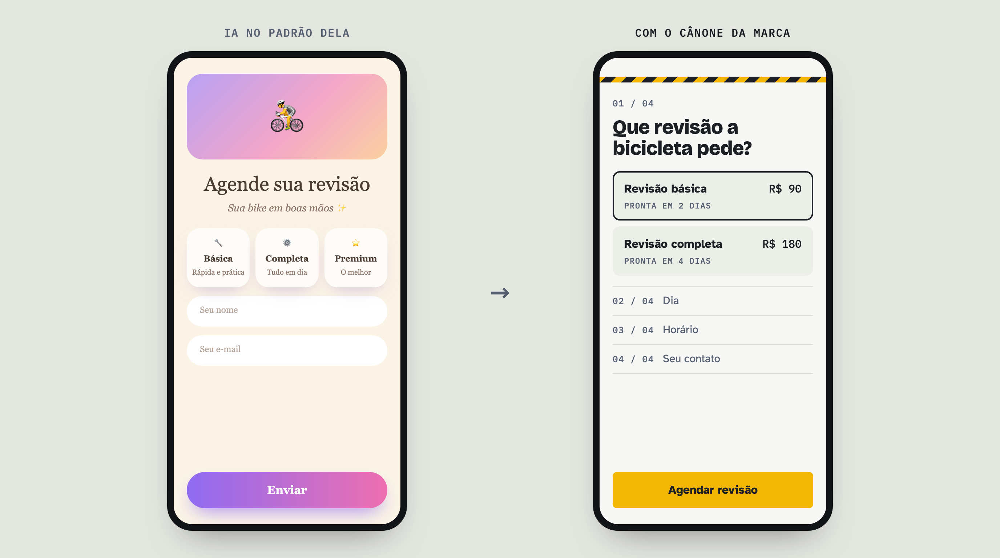

<p align="center">
  
</p>

<h1 align="center">sobrinho</h1>

<p align="center">
  Skill de design pra IA desenhar com a cara da sua marca, e aprender a cada tela.
</p>

<p align="center">
  <strong>Todo mundo tem um sobrinho que faz site. Este lê o manual da marca antes.</strong>
</p>

<p align="center">
  
  
  
</p>

---

**sobrinho** é uma skill pra agente de código (Claude Code e parecidos) que cuida do design de interface. Antes de desenhar ou reformar uma tela, ela lê o **cânone** da sua marca: as cores que já estão no ar e o papel de cada uma, as fontes, a forma, o que faz uma tela ser sua e o que a marca nunca faz. Depois de cada tela, anota o que funcionou e o que quebrou, e lê essas anotações na vez seguinte.

O kit vem com o método e com o cânone em branco. A identidade é sua: um guia de perguntas leva você a escrever o cânone da sua marca em uma ou duas horas, e a própria skill faz a entrevista se você preferir responder conversando.

## Pra quem serve

- Quem constrói site, app ou painel com IA e cansou de receber a mesma tela que todo mundo recebe.
- Marca pequena, estúdio ou pessoa que tem identidade e nunca escreveu as regras dela num lugar só.
- Quem já tem manual de marca em PDF e quer que a IA siga o manual de verdade.

Sem marca nenhuma ainda? O guia também serve pra decidir a primeira versão, com poucas cores e duas fontes.

## Antes e depois

O mesmo pedido, "desenha a página de agendamento de revisão", pra uma marca fictícia (Contravento, bicicletaria de bairro). A imagem lá em cima mostra as duas telas.

Com a IA no padrão dela:

```text
Fundo creme, título em serifa, botão arredondado em gradiente,
três cartões lado a lado com ícone colorido, foto de banco de imagem.
```

Com o cânone da Contravento:

```text
Fundo cal, título em Bricolage Grotesque, um botão amarelo com texto escuro,
faixa de sinalização uma vez no topo, etapas e preços em etiqueta mono
(01 / 04 · R$ 90 · PRONTA EM 2 DIAS), cantos de 6 px, preço antes do horário.
```

O cânone que fez essa virada está em [`exemplo/canone.md`](exemplo/canone.md), e o plano que a skill escreveu antes do código, em [`exemplo/plano-de-design.md`](exemplo/plano-de-design.md).

## Instala em 3 passos

1. **Clona na pasta de skills.**

   ```bash
   git clone https://github.com/renanburn/sobrinho ~/.claude/skills/sobrinho
   ```

2. **Escreve o cânone.** Chama `/sobrinho` no seu projeto. Com o cânone vazio, ela faz as perguntas do [`GUIA.md`](GUIA.md) uma por vez, lê os arquivos de estilo que já existem e preenche [`references/canone.md`](references/canone.md). Quem prefere responder por escrito segue o guia e preenche o arquivo.

3. **Pede uma tela.**

   ```text
   /sobrinho desenha a página de contato
   ```

   Ela escreve um plano curto, critica o plano, constrói com os seus tokens, tira screenshot e registra o que aprendeu.

Usa outra IA? O kit é markdown. Cola o `SKILL.md` e o seu `canone.md` na conversa e pede a tela.

## Como a skill trabalha

| Passo | O que acontece |
|---|---|
| **Lê** | o cânone inteiro, o receituário e as armadilhas, antes de qualquer decisão |
| **Escolhe a skin** | a mesma marca se comporta diferente no site e no painel; a tabela de superfícies do cânone decide |
| **Planeja** | 4 a 6 tokens de cor, papéis tipográficos, layout em wireframe de texto, uma assinatura, o que anima |
| **Critica** | parece o padrão de toda IA? fere regra dura? usa token que o cânone desconhece? |
| **Constrói** | cor, raio e fonte só por token, celular primeiro, contraste AA, foco visível, movimento reduzido respeitado |
| **Olha** | screenshot em 375 px e 1280 px, e tira um acessório |
| **Registra** | receita no receituário, tropeço nas armadilhas; regra nova vira proposta e espera a sua aprovação |

## Os 4 princípios

| Princípio | O que trava |
|---|---|
| **Cada fato mora num lugar só** | valor duplicado envelhece em dois lugares; o cânone aponta pro arquivo que manda |
| **O código em produção manda** | cânone e código discordaram, corrige o cânone ou corrige o código, nunca convive com os dois |
| **A skill propõe, você decide** | nenhuma regra entra no cânone sem a sua aprovação e sem ter passado por uma tela real |
| **Aprendizado só cresce** | receituário e armadilhas acumulam; o que deixou de valer ganha uma linha, e a história fica |

## Por dentro

- [`SKILL.md`](SKILL.md): o método. O que o agente lê quando você chama `/sobrinho`.
- [`GUIA.md`](GUIA.md): as perguntas que viram o seu cânone. Marca, superfícies, cor, tipografia, forma, movimento, assinatura, o que nunca fazer.
- [`references/canone.md`](references/canone.md): o modelo de cânone, em branco.
- [`aprendizado/`](aprendizado/): receituário e armadilhas, em branco, com o formato de cada entrada.
- [`exemplo/`](exemplo/): cânone, plano de design, receituário e armadilhas da Contravento, preenchidos.
- [`assets/`](assets/): a imagem de antes e depois, feita com a tela do exemplo construída em HTML.

## Estado honesto

O método roda todo dia em produto no ar. Este kit é a forma aberta dele e é novo: tem um exemplo só, de uma marca inventada. Cânones de marcas reais, que toparem aparecer, são o que mais falta. Ver [Contribuir](#contribuir).

## Contribuir

O [guia de contribuição](CONTRIBUINDO.md) explica como mandar um cânone que ficou bom e como melhorar as perguntas do guia.

## Licença

MIT. Ver [LICENSE](LICENSE).

---

Mantido por Renan Guaceroni (1RG). Outros kits: [marmita](https://github.com/renanburn/marmita), [saudade](https://github.com/renanburn/saudade), [gororoba](https://github.com/renanburn/gororoba) e [tempero](https://github.com/renanburn/tempero). Sistemas e mentoria: [1rg.com.br](https://1rg.com.br) e [@renan1rg](https://instagram.com/renan1rg).
